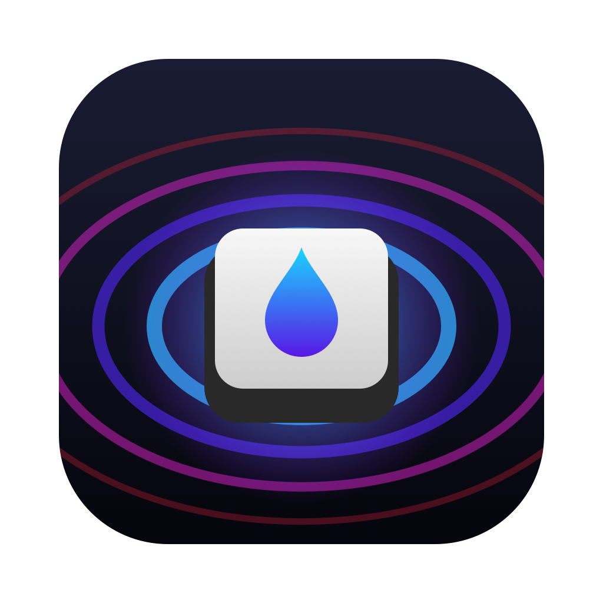

<p align="center"></p>

<h1 align="center">BA-KEY Menu</h1>

<p align="center">
<b>English</b> · <a href="README.pt-BR.md">Português (Brasil)</a>
</p>

<p align="center">
A native macOS menu bar app and CLI for the <b>Basike BA-KEY308</b> keyboard (Basike is a Brazilian brand),<br>
a <b>Dareu TK51G</b>-platform board (USB VID <code>0x260D</code>, PID <code>0x0130</code>), whose official software is Windows-only.
</p>

<p align="center">
<a href="https://github.com/ThePaladini/ba-key308-macos/releases/latest"><b>Download</b></a> ·
<a href="docs/PROTOCOL.md">Protocol</a> ·
<a href="docs/REVERSE-ENGINEERING.md">How it was reverse-engineered</a> ·
<a href="#other-dareu-keyboards">Other Dareu keyboards</a>
</p>

<p align="center">
<a href="https://www.youtube.com/shorts/qZohvX95IrM"></a><br>
<sub>▶ <a href="https://www.youtube.com/shorts/qZohvX95IrM">Demo video</a> (35 s) · <a href="https://www.youtube.com/shorts/MuPTBXvzvFQ">versão em português</a></sub>
</p>

---

The protocol was recovered by decompiling the official Windows configuration app. This app speaks
that protocol to the keyboard over **Bluetooth, the USB cable or the 2.4G receiver**. It needs no
drivers and no kernel extensions, it doesn't use the Windows code, and nothing runs in the background
unless you choose a Mac-rendered effect.

> **Unofficial.** Not affiliated with Basike or Dareu. It only sends commands from a reviewed
> allowlist (lighting and profiles); firmware-update and flash commands cannot be sent. See
> [docs/SAFETY.md](docs/SAFETY.md). Use at your own risk.

## Supported keyboards

All of these are the same Dareu reference design, internally called **TK51G**, sold under different brands.

| Keyboard | Layout | USB PID (VID `0x260D`) | Status |
|---|---|---|---|
| **Basike BA-KEY308** | ABNT2 | `0x0130` | ✅ tested (Bluetooth, USB); per-key LED map calibrated |
| **Dareu EK75** | ANSI | `0x0101`, `0x0045` | 🧪 experimental: recognized, not tested yet; per-key LED map inferred |
| **Husky Nomadic HTG200 / HTG500 / HTG800 V2** | ANSI | `0x0101` | 🧪 experimental (same hardware as the EK75) |
| 2.4G receiver for the models above | n/a | `0x0042` | implemented, not tested yet |
| Other Dareu keyboards with the same protocol (`FwType 0`): Z82 / Z82 PRO, A98, FK98, A87 PRO, EK87 PRO, A104, EK106 PRO, EK81 MAX, COOL 98, DK87 PRO, DK108 PRO, EK815 MAX, FLEX 75 | various | see [catalog](docs/DAREU-CATALOG.md) | ❔ probably work for effects; not recognized by the app yet; `bakey info` detects them, please report |
| Newer EK75 revisions, CK75 PRO, Hall-effect "HE/RT" boards (`FwType` ≠ 0) | | | ❌ different protocol |

The full list comes from Dareu's public web-driver catalog, scanned for this project:
[docs/DAREU-CATALOG.md](docs/DAREU-CATALOG.md). How we know they're the same platform: Dareu's public web-driver catalog lists PIDs `0x0101` and
`0x0045` as `"Model": "TK51G"`, and the Husky Nomadic is documented by
[open-ek75](https://github.com/mateusands/open-ek75) as a rebadged EK75. Two independent Linux projects
([open-ek75](https://github.com/mateusands/open-ek75),
[Dareu-EK75-OpenRGB-Compat](https://github.com/KitsuneSemCalda/Dareu-EK75-OpenRGB-Compat)) speak the same
protocol. **Own one of these, or another `0x260D` keyboard?** Please
[send a compatibility report](https://github.com/ThePaladini/ba-key308-macos/issues/new?template=compatibility-report.yml).
The `bakey info` command used for it is read-only.

## Features

- **Menu bar panel**
  - Connection type, firmware version, battery level (optionally in the menu bar).
  - **Backlight**: all 19 hardware effects, color (swatches, color picker or the firmware rainbow),
    direction, brightness, and a speed slider covering the firmware's full 1–255 range (the official
    app only uses 1–3).
  - **Mac effects**: effects drawn by the Mac, with full speed control:
    - **Raindrop on key press**: ripples spread from the key you press.
    - Random Rain, Wave and Breathing.
  - **Side light**: off / static / breathing, color, brightness.
  - **Bluetooth batteries**: the battery of your mouse, headphones or any other Bluetooth device, with a
    pin to show it next to the menu bar icon ([docs/BATTERIES.md](docs/BATTERIES.md)).
  - Launch at login.
- **Key Painter**: click or drag to color individual keys. Includes an eyedropper, fill, built-in
  layouts (WASD, arrows, rainbow…) and saved layouts. Colors are re-sent when the keyboard reconnects.
- **`bakey` CLI**: `bakey info`, `bakey effect back wave --speed 3`, `bakey keys W=ff0000 A=ff0000 …`,
  raw read-only queries, benchmarks.

Keyboard effects are stored **on the keyboard** and keep working on any computer without the app.

## Install

1. Download `BA-KEY-Menu-x.y.z.zip` from the [latest release](https://github.com/ThePaladini/ba-key308-macos/releases/latest)
   and unzip it.
2. Move **BA-KEY Menu.app** to **/Applications**.
3. The app is not notarized by Apple, so the first launch needs one extra step. Right-click the app →
   **Open** → **Open**. On recent macOS versions, if that doesn't offer an Open button, go to System
   Settings → Privacy & Security → **Open Anyway**, or run:
   ```bash
   xattr -dr com.apple.quarantine "/Applications/BA-KEY Menu.app"
   ```
4. A keyboard icon appears in the menu bar (there is no Dock icon). Tick **Launch at login** if you want it always on.

Optional: the CLI is in the same release (`bakey-x.y.z.zip`). Put it somewhere on your `PATH`.

**Permissions:** only the *Raindrop (Mac, on key press)* effect needs **Input Monitoring**, because it
has to see which key you pressed. The app asks when you first select it. It uses key presses only to
place the ripple and doesn't record or store them.

Requires macOS 13 Ventura or newer, on Apple Silicon or Intel. Tested on macOS 26.

## Which effect when?

| You want | Use | Works over |
|---|---|---|
| A slow raindrop-like effect, everywhere | **Area Reactive** (keyboard effect), speed slider at the left | everything; no app needed |
| A built-in effect faster than the official app allows | Keyboard effect, speed slider to the right | everything |
| Key-press ripples at any speed | **Raindrop (Mac, on key press)** | smooth on USB; usable on Bluetooth at low speed |
| Mac-drawn Wave / Breathing | Mac effects | smooth on USB; ~6 updates/s on Bluetooth |
| Your own per-key colors | **Paint individual keys…** | everything |

Why Bluetooth is slower for Mac-drawn effects: each lighting packet waits for a Bluetooth
connection event, about 154 ms on this keyboard versus about 1 ms on USB. The app works around it by
sending only the keyboard rows that changed. Details are in [docs/BLUETOOTH.md](docs/BLUETOOTH.md).

## Build from source

```bash
git clone https://github.com/ThePaladini/ba-key308-macos.git
cd ba-key308-macos
scripts/make-dev-cert.sh          # optional, once: stable local signing so macOS keeps permissions across rebuilds
scripts/build-app.sh --install    # builds (universal), installs to /Applications + `bakey` to ~/.local/bin, launches
```

Development:

```bash
swift build          # debug build
swift test           # unit tests (no keyboard needed)
swift run bakey info # CLI against a connected keyboard
```

Requires Xcode or the Command Line Tools (Swift 5.9+).

## CLI

```
bakey info                          Device, firmware, battery, current lighting
bakey effects                       Effects supported by each lighting region
bakey effect <back|side> <name|id> [--color RRGGBB] [--speed 1-255] [--reverse]
bakey brightness <back|side> <0-100>
bakey fill <RRGGBB>                 All keys one color (per-key mode)
bakey keys W=ff0000 A=ff0000 … [--base RRGGBB]
bakey layout                        Key labels, IDs and LED cells
bakey get <class> <cmd> [bytes…]    Raw read-only command (GET only)
bakey effect-raw <back|side> <effect> <flag> <speed> [RRGGBB]   Unclamped, for experiments
bakey listen [seconds]              Show key presses as the app sees them
bakey lab sustained|async|partial|fill   Bluetooth experiments
bakey bench                         Link latency / frame rate
bakey demo [seconds]                Mac-driven rainbow animation
bakey showcase [countdown]          ~40 s timed light show for filming (adapts to Bluetooth/USB)
-v                                  Print every packet
```

## Other Dareu keyboards

The BA-KEY308 is a rebadged **Dareu "TK51G"** design (model code `TK51G_0130`). The protocol lives in
Dareu's shared `DeviceBase.dll`, which their Windows apps use across many products. Other
Dareu-based keyboards (`VID 0x260D`) very likely speak the same protocol, with a different PID, key
table and LED matrix.

To adapt this project:

1. Check that your keyboard exposes a 64-byte feature report:
   `ioreg -r -c IOHIDDevice -l | grep -A40 '"VendorID" = 9741'` should show `MaxFeatureReportSize = 65`.
2. Try `bakey info` after changing `BAKey.keyboardPID` in `Sources/BAKeyCore/Protocol.swift`.
   Read-only GETs are safe.
3. Extract the key table from your model's `Products/*.dll` with the scripts in [`tools/`](tools/) and
   **calibrate the LED matrix with test frames**. The Windows app's own matrix table was wrong for this
   model; see [docs/KEY-MATRIX.md](docs/KEY-MATRIX.md).

The full method is in [docs/REVERSE-ENGINEERING.md](docs/REVERSE-ENGINEERING.md). Pull requests for
other models are welcome.

## Documentation

| Document | Contents |
|---|---|
| [PROTOCOL.md](docs/PROTOCOL.md) | The HID protocol: packet format, handshake, every command class, captured examples |
| [KEY-MATRIX.md](docs/KEY-MATRIX.md) | Key IDs and the calibrated per-key LED matrix |
| [BLUETOOTH.md](docs/BLUETOOTH.md) | Why Bluetooth is slow for lighting, the experiments, the row-diffing workaround |
| [SOFT-EFFECTS.md](docs/SOFT-EFFECTS.md) | Mac-rendered effects, the native Raindrop speed investigation, adding an effect |
| [DAREU-CATALOG.md](docs/DAREU-CATALOG.md) | Every product in Dareu's public catalog: platform, firmware type, and what that means for compatibility |
| [BATTERIES.md](docs/BATTERIES.md) | How the Bluetooth battery levels are read, and their limits |
| [ARCHITECTURE.md](docs/ARCHITECTURE.md) | Code organization and design decisions |
| [SAFETY.md](docs/SAFETY.md) | Commands that can brick the keyboard, and how this project prevents them |
| [REVERSE-ENGINEERING.md](docs/REVERSE-ENGINEERING.md) | Step-by-step log of how the protocol was recovered |
| [TROUBLESHOOTING.md](docs/TROUBLESHOOTING.md) | Common problems |
| [CHANGELOG.md](CHANGELOG.md) | Release notes |

## Status

| | |
|---|---|
| Bluetooth LE | ✅ tested |
| USB cable | ✅ tested (about 130× faster than Bluetooth for lighting) |
| 2.4G receiver | implemented from the Windows code, **not tested yet** |
| Dareu EK75 / Husky Nomadic | recognized since v1.1.0, **not tested yet** |
| Lighting effects, color, speed, brightness, side light | ✅ |
| Per-key colors, Mac effects, key-press Raindrop | ✅ |
| Battery, firmware info | ✅ |
| Key remapping, macros, sleep timer | protocol documented, not implemented |

## License

[MIT](LICENSE). The keyboard's names and trademarks belong to their owners. This repository contains
no code or binaries from the vendor's software. Protocol facts, key positions and the default key
map were derived from it for interoperability.
